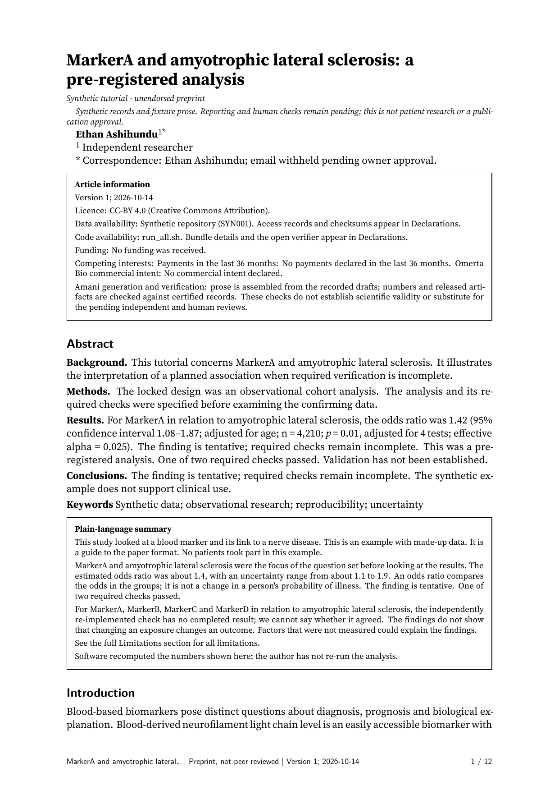
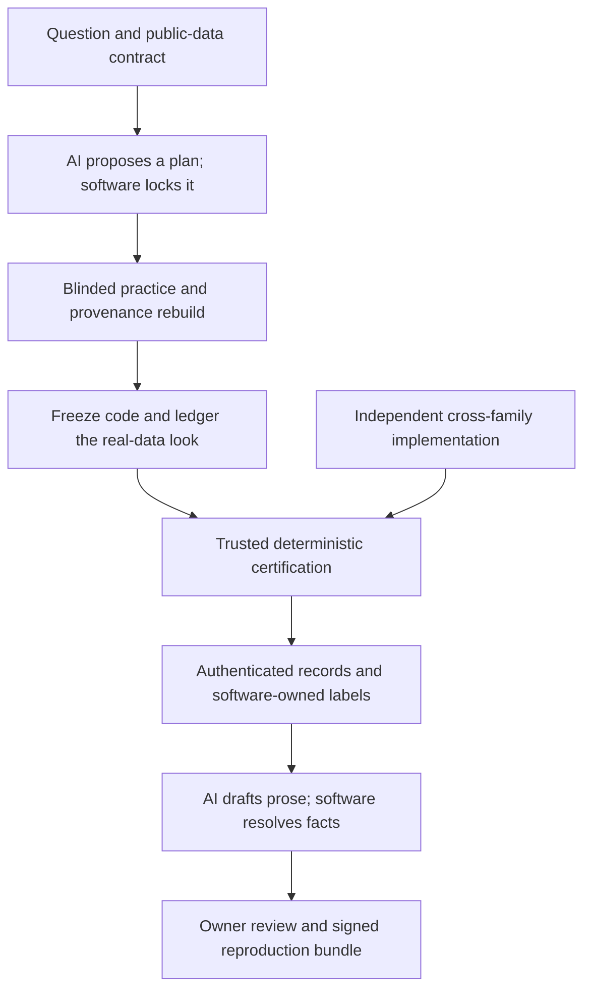
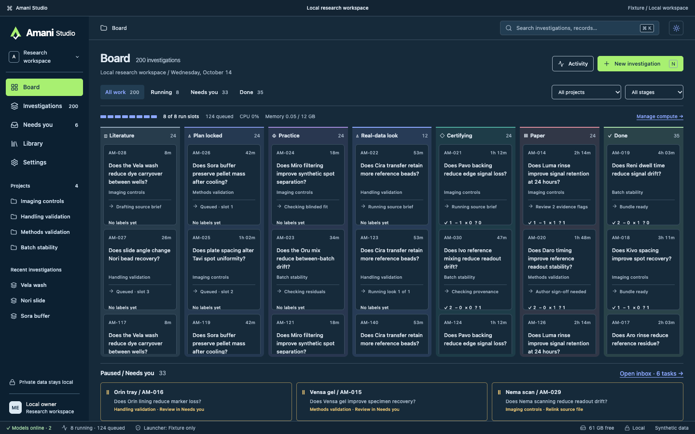

<div align="center">

<h1>Amani</h1>

<p><strong>Autonomous biomedical research, with an untrusted AI generator inside a trusted deterministic checker.</strong></p>

[](package.json)
[](package.json) <!-- Source: package.json engines.node. -->
[](LICENSE)

[Blind replications](#blind-replications) · [Architecture](#how-it-works) · [Evidence](#results-and-evidence) · [Quickstart](#quickstart) · [Docs](docs/architecture.md)

</div>

## Blind replications

Amani was given research questions and public data with the study identity hidden: disease, gene and variable names were replaced, rows and columns permuted, and values or coordinates transformed where needed to preserve the relevant statistical structure while removing recognizable fingerprints. It worked blind.

These **retired Tier B cases** scored **59 of 66 grading criteria on sealed one-shot cases**. The blind papers keep the coded names; the reveals show the real studies, disguise methods and reproduced findings.

| Case / real study | What Amani reproduced | Grade | Blind paper |
|---|---|---|---|
| [C3: Infliximab response](examples/replications/infliximab-response/README.md) | Higher expression in non-responders; detected cohort overlap and loss of adjusted specificity | **8/8** | [PDF](examples/replications/infliximab-response/paper.pdf) |
| [C4: Factor XI](examples/replications/factor-xi/README.md) | FXI outcome ordering: strongest protection for VTE, then cardioembolic stroke; bleeding arms inconclusive | **18/18** | [PDF](examples/replications/factor-xi/paper.pdf) |
| [C1: GPNMB and Parkinson’s](examples/replications/gpnmb-parkinsons/README.md) | Higher GPNMB associated with higher Parkinson’s risk in both cohorts, with a weaker replication estimate | **14/16** | [PDF](examples/replications/gpnmb-parkinsons/paper.pdf) |
| [C2: Muscle splicing](examples/replications/muscle-splicing/README.md) | Cross-muscle splicing concordance, comparator overlap and appropriate limits on generalisation | **12/15** | [PDF](examples/replications/muscle-splicing/paper.pdf) |
| [C5: Batch adjustment](examples/replications/batch-adjustment/README.md) | Both published discovery counts: 2,011 after pre-adjustment; 11 with batch in the model | **7/9** | [PDF](examples/replications/batch-adjustment/paper.pdf) |

Explore the [full showcase, study reveals and data](examples/replications/README.md). The cases include association replication, audits of stronger publication claims and a reproduced batch-effect artifact.

Amani turns a research question and public biomedical data into an auditable investigation. Coding agents propose hypotheses, analysis code and prose; a separate software kernel controls data exposure, recomputes results and decides which claims the evidence supports.

The research engine runs investigations, Amani Studio provides supervision, and the paper toolchain produces journal-style manuscripts with signed evidence and reproducible bundles.

## Guarantees by construction

- **Plan before exposure.** Hash-lock the data contract, estimand, analysis and decision policy before the real-data look. Later changes cannot relax software-owned thresholds.
- **Practice without an answer channel.** Generate blinded practice data from a closed inventory of permitted structure. A provenance-rebuild audit reconstructs the artifacts without source measurements and checks the bytes.
- **Exactly one real-data look.** Ledger exposure before executing frozen code; refuse another unrecorded confirmatory look. <!-- Source: docs/architecture.md, one-look protocol; packages/omb-store/BUILD-NOTES.md, confirm boundary. -->
- **Registry-owned decisions.** Registered procedures own decision rules and calibrated design envelopes. A model-written result cannot authorize its own statistical policy.
- **Cross-family review.** Independently reimplement the analysis and review methods using a different model family; preserve disagreement in the evidence.
- **Software-owned labels and numbers.** Missing checks never promote a claim. Reports resolve facts from authenticated records rather than accepting numbers typed by a drafter.
- **Reviewable papers.** Constrained prose, deterministic displays, citation checks, signed rendering, explicit owner endorsement and reproduction inputs connect manuscripts to investigations.

<!-- Source: docs/architecture.md; docs/labels-and-certification.md; packages/omb-report/README.md; packages/omb-package/README.md, implemented trust boundaries and paper verification. -->

## Results and evidence

<!-- Source: race/gauntlet/README.md, Claude-free reference regression (2026-10-14), pinned build refs and linked evidence; superseded results replaced by the integration record below. -->

| Evidence | Measured result | Scope |
|---|---|---|
| Claude-free development gauntlet | **24/24 on three consecutive runs**: each run had **22 complete-correct results and two correct scientific abstentions**. <!-- Source: owner review, 2026-10-15, confirms integrated main c08c03a341b44a352a90aa83a6f2a84d89886bab; ~/projects/omerta-bio-wt/_logs/integrate-main.json reference_regression and integrate-main.last.md record the 3 runs on ancestor 058cf48cfaccee45f50e2758a237763289a721fb. The report lists the CI receipt; it was not opened for this revision. c08c03a3 changes publication-audit tooling only. --> | Reference regression on integrated main `c08c03a3`. Injected workers exercise native execution and decisions across 24 synthetic cards, without Claude inference. |
| Retired Tier B evaluation | **59/66 criteria passed (89%)**. <!-- Source: docs/validation.md, Tier B aggregate result. --> | Frozen one-shot internal evaluation. |
| Integration test record | **10,075 passed, 19 skipped, no failures**. <!-- Source: INTEGRATION-NOTES.md, final result following PW8 review-fix integration. --> | Recorded root development-suite run. |
| Portable CI selector | **43 files / 840 tests passed** locally. <!-- Source: docs/CI.md, Lightweight GitHub Actions. --> | Portable Linux checks defined in Actions. |

Full CI checks on main are green, with the **publication audit pending**. CI tests pinned commits in disposable checkouts and covers native analysis, reproducibility, licences and release packaging. See the [CI guide](docs/CI.md). <!-- Source: owner review, 2026-10-15, main c08c03a3 status; integrate-main.json and integrate-main.last.md record passed CI stages on ancestor 058cf48c and list the receipt. -->

The **live-model gauntlet is in progress**, and the **plain Claude / Codex / Biomni race is in progress**. No winner is claimed. <!-- Source: race/README.md defines comparative arms; race/gauntlet/README.md defines development-regression scope. Current live-model gauntlet and race status supplied by the owner, 2026-10-15. -->

## From investigation to paper

Amani turns authenticated investigation records into journal-style manuscripts. The paper-input builder verifies lineage; typed fact slots supply numbers and protected wording; figures and tables regenerate from the same records. A drafter supplies the narrative under numeric and citation constraints, followed by cross-family manuscript review, spin review and final-diff review.

The renderer signs fact-bearing spans and verifies emitted artifacts. Packaging requires trusted upstream verifiers, owner review and endorsement receipts, then signs the final certificate and bundle manifest. It produces submission and reproduction artifacts for owner review. <!-- Source: packages/omb-report/README.md; packages/omb-package/README.md, upstream verifier and endorsement requirements. -->



*One generated paper page: a synthetic tutorial with illustrative records and prose.* <!-- Source: ~/projects/omerta-bio-wt/_logs/paper-layout-sample-01.png, copied byte-for-byte; page explicitly identifies synthetic records and fixture prose. paper-short-polish-results.json identifies paper-layout-sample.pdf as the fixture; packages/omb-package/README.md describes the synthetic sample. -->

Explore the [report core](packages/omb-report/README.md), [paper packaging](packages/omb-package/README.md) and [architecture](docs/architecture.md).

## How it works



The scheduler admits workers under resource and model-family constraints. Workers exchange artifacts across the trust boundary. The host freezes inputs and code, maintains a hash-chained event store, runs analysis offline, and applies certification gates to the artifacts actually produced.

Practice blinding goes beyond changing identifiers. The compiler emits a constrained inventory; the renderer receives that inventory rather than source rows. A separate process rebuilds the practice artifacts to test whether their provenance is explained by the permitted input language. <!-- Source: packages/omb-investigate/src/practice-provenance.ts, compilePractice/renderPractice/auditRebuild. -->

| Claim label | Meaning |
|---|---|
| **Confirmed** | Required checks passed within this dataset, method and calibrated envelope. |
| **Tentative** | A verified result lacks a required confirmation check. |
| **Refuted** | The prespecified effect is ruled out with the required power and checks. |
| **Insufficient evidence** | The data or checks cannot settle the claim. |
| **Exploratory / non-identifiable** | The claim is outside the confirmatory path, or the effect cannot be identified from these data. |

See [labels and certification](docs/labels-and-certification.md). Scientific failures ordinarily lower a claim's label while preserving the record. Positive evidence of a containment or evidence-integrity breach can stop the run; the governing contract distinguishes those events from an unavailable check.

## Amani Studio



*Amani Studio investigation board, shown with illustrative fixture data.* <!-- Source: apps/amani-studio/screenshots/README.md; board-dark-1440x900.png copied here because the public export excludes that directory. -->

## Quickstart

The supported research runtime is **macOS on Apple silicon**, with **Node 24** and **pnpm 11.4.0**. <!-- Source: docs/getting-started.md requirements; package.json engines/packageManager; packages/bio-baseline/pixi.toml platform. --> Install [pixi](https://pixi.sh) for the pinned analysis environment. Real investigations also require configured, authenticated coding-agent providers.

```sh
git clone https://github.com/ethanashi/amani.git
cd amani
pnpm install --frozen-lockfile
pixi install --frozen --manifest-path packages/bio-baseline/pixi.toml
pnpm typecheck
```

For a prepared task, set `TASK_DIR` to its absolute served-task directory and `ATTEMPT_DIR` to an empty, separate output directory:

```sh
OMB_LIVE=1 node --experimental-transform-types --no-warnings \
  packages/omb-amani/src/release-cli.ts run \
  --task "$TASK_DIR" --out "$ATTEMPT_DIR" --mode card
```

<!-- Source: packages/omb-amani/src/release-cli.ts, cli-args.ts and run.ts; literal 1 explicitly enables live workers. -->

A served task contains `TASK.md`, `data/`, `DATA-CONTRACT.json` and `manifest.json`. `OMB_LIVE=1` selects authenticated live workers; omitting it selects simulated workers. The CLI consumes prepared task directories. See [getting started](docs/getting-started.md) for output records and prerequisites.

The public repository is an **audited source snapshot** exported through the publication tooling. Its export policy retains the research engine and documentation while excluding development tests, raw validation trees and private material. <!-- Source: scripts/publish/ publication policy. -->

## Configuration

| Setting | Purpose |
|---|---|
| `OMB_LIVE` | Explicit opt-in to real provider execution. |
| `OMB_CODEX_CLI`, `OMB_CLAUDE_CLI` | Installed provider executables; the Claude adapter enforces its recorded CLI pin. |
| `OMB_CODEX_MODEL` | Override the Codex analysis model. |
| `OMB_LOAD_CEILING` | Scheduler admission ceiling for host load. |
| `AMANI_ENGINE_ROOT` | Isolate Studio's durable workspace. |
| `AMANI_PROVIDERS_CONFIG` | Select Studio's provider configuration; use the native credential path for secrets. |

Studio uses component-specific provider configuration and native credential storage. Read [provider status](docs/providers.md) and the [Studio README](apps/amani-studio/README.md) for the component you run.

Confirmed requires the certification launcher's separation between analyst and authority OS accounts. Runs without that separation are capped at Tentative. Launcher installation is an owner-managed prerequisite separate from JavaScript dependency installation.

## Project layout

| Path | Responsibility |
|---|---|
| `apps/amani-studio/` | Desktop review surface and engine bridge. |
| `packages/omb-amani/`, `omb-investigate/`, `omb-sched/` | CLI, investigation lifecycle, scheduling and practice-data construction. |
| `packages/omb-contract/`, `omb-procedures/`, `omb-gauntlet/`, `omb-certify/` | Data semantics, registered methods, decision gates and certification. |
| `packages/omb-store/`, `omb-launcher/` | Evidence storage, exposure accounting and OS-account boundary. |
| `packages/omb-paper/`, `omb-report/`, `omb-drafter/`, `omb-figures/`, `omb-package/` | Authenticated inputs through manuscript and reproduction packaging. |
| `packages/bio-*/` | Shared primitives, pinned analysis environment and earlier integration components. |
| `docs/`, `scripts/ci/`, `scripts/publish/` | Architecture, validation, commit-pinned checks and audited export. |

## Development and testing

In a **development checkout containing test sources**:

```sh
pnpm typecheck
pnpm exec vitest run packages/omb-contract --maxWorkers=2
pnpm test
```

<!-- Source: package.json scripts; focused Vitest invocation follows docs/getting-started.md, maxWorkers limits concurrency. -->

The focused contract check passed **692 tests** during the initial README validation. <!-- Source: docs/readme-validation.md, focused contract command and result. --> Dependency installation and root typechecking also passed; see the [verification record](docs/readme-validation.md). The contract suite runs offline; the full suite uses component-specific native runtimes and fixtures. Live-provider tests require explicit opt-ins.

Paper packaging uses its own pinned runtime and renderer; read its README before running `sample`. The owner reviews and endorses manuscript artifacts before publication.

## Limitations

- Computational biomedical research is bounded by procedure assumptions, simulation envelopes, contamination risk, identifiability and power; it is not clinical validation.
- The evaluations above are developer-run. The reference gauntlet measures software behavior, and Tier B criteria are not independent studies. Recorded counts apply to their source revisions; the portable result is a local run.
- macOS runtime and launcher prerequisites apply. Studio's full manuscript endorsement integration and broader platform validation remain in progress.
- Publication audit pending. Synthetic paper previews carry no human endorsement; publication requires authenticated verification and owner review.

## License

The Amani engine is licensed under [AGPL-3.0-only](LICENSE), copyright 2026 Ethan Ashihundu.
The independent [verifier](packages/omb-verifier/) and [certificate format](packages/omb-certificate/)
are licensed under Apache-2.0, so certificates can be checked without importing the engine.
Verification authenticates signed bundle bytes; it does not rerun scientific gates or confer a label.
Studio retains its [MIT license](apps/amani-studio/LICENSE). Third-party components retain their own
licenses; see [NOTICE](NOTICE) and the [dependency inventory](docs/third-party-licenses.md).
Contributions require acceptance of the [CLA](CONTRIBUTING.md).

## Commercial licensing

A separate commercial license for the AGPL engine is available by agreement with the maintainer.
For licensing enquiries, open a [GitHub issue](https://github.com/ethanashi/amani/issues)
or [discussion](https://github.com/ethanashi/amani/discussions).

## Acknowledgements

Built with coding-agent contributions from Codex and Claude Code under the owner's direction. Analysis and verification build on TypeScript, Python, R and independent reference software including `metafor` and `Surrogate`. Studio uses React and Tauri. Vendored dependencies retain their notices and attribution.
