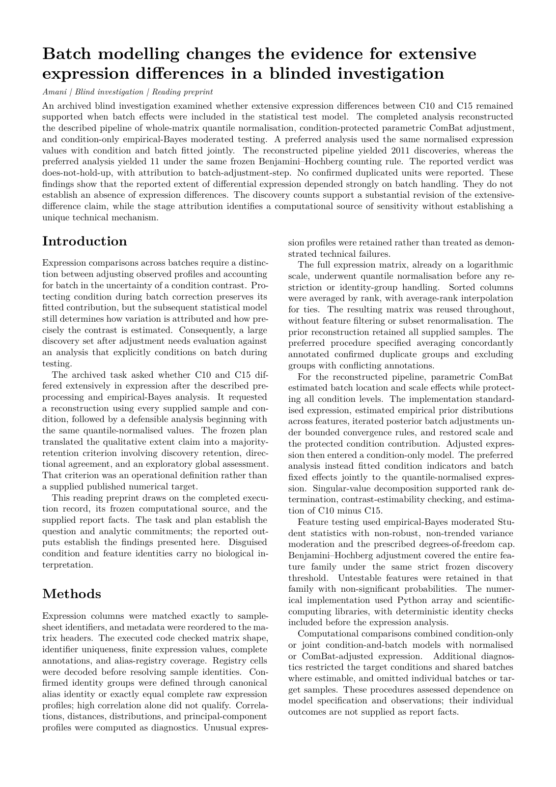

# Batch adjustment: reproducing a statistical artifact

Amani reproduced both published discovery counts in the batch-effect reanalysis: **2,011** from the prior pipeline versus **11** with batch included in the test model. The retired case passed **7/9 criteria**.

[Blind paper PDF](paper.pdf) · [page-one PNG](paper-page-1.png) · [paper source](paper.md) · [evaluated report](report.json) · [grade](grade.json) · [all retired Tier B cases](../README.md)



## The reveal

**Methods that remove batch effects while retaining group differences may lead to exaggerated confidence in downstream analyses.** Vegard Nygaard, Einar Andreas Rødland and Eivind Hovig (2016). [DOI: 10.1093/biostatistics/kxv027](https://doi.org/10.1093/biostatistics/kxv027). The paper linked above was drafted with the disguised names; this reveal was written separately afterwards.

| What Amani saw | Real identity |
|---|---|
| C10 | GA.DP: Copaxone / glatiramer acetate treatment |
| C15 | GA.Q: Glatimer / generic glatiramoid comparison |
| Other C-coded conditions | The remaining treatment and control groups in GSE40566 |
| A-expression | GSE40566 mouse lymphocyte microarray expression; GPL6887 |
| A-samples | Sample labels joined from GSE40566 and GSE61901 |
| Empirical-Bayes location/scale adjustment | Parametric ComBat protecting all condition levels |
| batch_01–batch_18 | Original array-chip identifiers |
| F… / S… | Illumina feature/probe identifiers / sample identifiers |

## How it was disguised

Drug, species, tissue, platform, study, author and accession names were hidden. Probe and sample identifiers were keyed, conditions were recoded C01–C16 and chips batch_01–batch_18. Probe rows and sample columns were permuted. The expression matrix retains the original unnormalised log2 values; no artificial scaling was applied. The task describes the original procedure without naming ComBat or giving the published discovery count. This preserves the unbalanced batch/condition design that causes the artifact while removing drug and study recognition cues. Correctly naming the ten highest-ranked disguised features also requires working with the coded data, rather than reciting the published counts.

## Amani's blind result beside the published finding

| Finding | Published finding | Amani's blind result |
|---|---|---|
| Prior pipeline | Nygaard et al. reproduced 2,011 differentially expressed features at 5% FDR after quantile normalisation, condition-protecting batch adjustment and limma. | 2,011 features, with the reproduced top-feature set meeting its grading criterion. |
| Sound batch handling | Including batch directly in the model reduced the result to 11 features. | 11 features with batch “in-model”; verdict “does-not-hold-up”, cause “batch-adjustment-step”. |

This reproduces the published feature-count contrast and its batch-adjustment explanation. The biological setting is a mouse-cell experiment comparing formulations used in multiple sclerosis treatment; it is not a clinical efficacy comparison.

**Grade: 7/9 criteria.** This is the sealed one-shot grade from the final blind run, retained unchanged after retirement. Benchmark criteria and the software kernel's scientific claim labels are distinct: the reading paper preserves the native labels and pending manuscript-review status. It is not an endorsed submission package.

## Data and licence

**Fetch-only.** Inputs come from public GEO [GSE40566](https://www.ncbi.nlm.nih.gov/geo/query/acc.cgi?acc=GSE40566) and [GSE61901](https://www.ncbi.nlm.nih.gov/geo/query/acc.cgi?acc=GSE61901). No dataset-specific redistribution licence was established, so no expression matrix is bundled. See the [GEO rights disclaimer](https://www.ncbi.nlm.nih.gov/geo/info/disclaimer.html). The fetcher downloads the unnormalised matrix and both sample-metadata records, runs the case’s label-joining staging code, and recreates the disguised inputs deterministically.

From the repository root:

```sh
nice -n 10 python3 examples/replications/batch-adjustment/fetch_data.py
```

[Fetcher](fetch_data.py) · [staging code](stage_data.py) · [projection recipe](projection.json.gz) · [data contract](DATA-CONTRACT.json). The recipe records curation name maps and row/column permutations, with measurements read from the original downloads. Every recreated served-file checksum is verified. Pass a destination directory as the first argument to write the data elsewhere.

## The question Amani received

The following is verbatim from the served task, including the disguised data description and analysis instructions. [The complete served task](TASK.md) also includes the file inventory and report-field specification.

<details>
<summary>Read the served question and disguised data description</summary>

````text
A prior report states that conditions C10 and C15 differ extensively in expression: many features reach 5% FDR after quantile normalisation, empirical-Bayes batch adjustment protecting condition, and limma.

The prior pipeline, as described by its authors, used every sample and every condition at each step:
1. quantile normalisation of the whole expression matrix;
2. empirical-Bayes location/scale batch adjustment (parametric priors), with batch as the batch variable and condition (all levels) as the protected covariate;
3. a limma linear model with one coefficient per condition, the contrast C15 subtracted from C10, moderated t statistics and Benjamini-Hochberg FDR.

Does this claim hold up? You have the expression matrix (features in rows, samples in columns, values already on a log2 scale, not normalised) and a sample sheet that gives each sample's batch and condition. Re-run the prior pipeline as described. Then analyse the comparison in the way you consider sound, starting from the quantile-normalised values of step 1 (every later choice is yours), and report counts, methods and verdict.

Counts are numbers of features with Benjamini-Hochberg adjusted p < 0.05 for C10 versus C15. Where a field asks for the features with the smallest p-values, rank them by the p-value of the C10 versus C15 comparison, smallest first.

Fill every graded field listed under Report below. Also include these ungraded fields in `report.json`:
- `/data_integrity/other_problems`: other data-quality problems found (a list of short strings; empty if none);
- `/data_integrity/units_of_analysis`: units of analysis used (a string);
- `/methods`: your methods, in prose (a string).
````

</details>

## Records and reproduction

[Paper inputs](paper-input.json) preserve the blinded task, frozen executed code, selected evaluated facts and native scientific claim statuses. [Draft provenance](drafter-provenance.json) records the live Codex call and usage. [Build checks](build.json) record journal/phase-chain, frozen-code, output-snapshot, deliverable and served-manifest checks, PDF hash and zero overfull warnings. The reveal and grading answer were not supplied to the paper drafter.

The original investigation was not rerun or regraded for this showcase. Data staging and document rendering were replayed separately. The paper uses Amani's journal preprint layout; cross-family manuscript review and owner endorsement remain pending.
