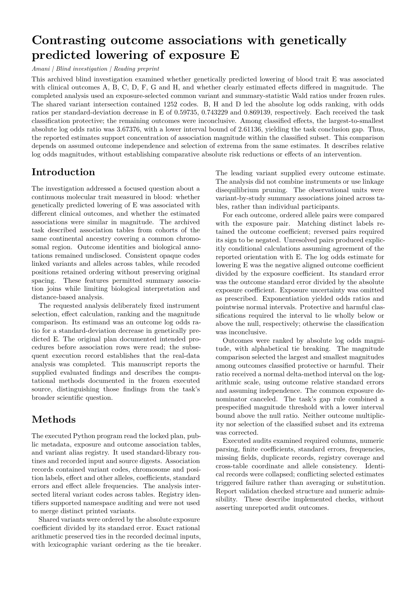

# Factor XI: a stronger venous than arterial association

Amani recovered the ordering of the FXI associations across seven outcomes, with the largest protective estimate for venous thromboembolism. The retired case passed **18/18 criteria**.

[Blind paper PDF](paper.pdf) · [page-one PNG](paper-page-1.png) · [paper source](paper.md) · [evaluated report](report.json) · [grade](grade.json) · [all retired Tier B cases](../README.md)



## The reveal

**Leveraging genetic predictors of factor XI levels to anticipate results from clinical trials.** Iyas Daghlas and Dipender Gill (2023). [DOI: 10.1111/ene.15820](https://doi.org/10.1111/ene.15820). The paper linked above was drafted with the disguised names; this reveal was written separately afterwards.

| What Amani saw | Real identity |
|---|---|
| Exposure E | Plasma factor XI (F11 / FXI) |
| Outcome B | Venous thromboembolism; GCST90451757 |
| Outcome H | Cardioembolic stroke; GCST90104541 |
| Outcome D | Any ischaemic stroke; GCST90104540 |
| Outcome C | Large-artery stroke; GCST90104542 |
| Outcome F | Small-vessel stroke; GCST90104543 |
| Outcome G | Gastrointestinal haemorrhage; GCST90476109 |
| Outcome A | Intracranial haemorrhage; GCST90479221 |
| E exposure source | GCST90469165, open plasma F11 pQTL summary statistics |
| V18669175 | rs2289252, selected lead instrument |
| n1 / n2 / n3 / n4 | A / C / G / T alleles |

## How it was disguised

Gene, outcome, consortium, platform and accession names were removed. Dataset letters were assigned without an outcome-order hint. Variant identifiers, chromosome labels and row order were keyed; alleles were consistently recoded as n1–n4. Coordinates were remapped in order with keyed spacing, so original locus coordinates and distances could not identify F11. Before projection, beta and standard error were rounded half-even to four significant digits, allele frequency to two decimals, and p-values were dropped. Each source was re-sliced so row counts did not encode cohort sample sizes. These changes preserve harmonised association estimates and variant ordering while removing the recognizable locus and disease names. Published effect sizes are not the case’s answer: the open exposure source and mandated single-instrument estimator produce different magnitudes.

## Amani's blind result beside the published finding

| Finding | Published finding | Amani's blind result |
|---|---|---|
| Venous versus arterial ordering | Per SD lower FXI: VTE OR 0.54 (0.49–0.59), any ischaemic stroke OR 0.90 (0.87–0.93). | VTE OR 0.59735; any ischaemic stroke OR 0.86914. The ratio of absolute log odds effects was 3.67376, with lower interval bound 2.61136. |
| Stroke subtypes and bleeding | Cardioembolic stroke had the largest stroke-subtype association; the published analysis found no increased bleeding signal. | Cardioembolic stroke OR 0.74323, ranking after VTE and before any ischaemic stroke. Large-artery, small-vessel and both bleeding outcomes were classified as inconclusive. |

This reproduces the direction and ordering of the published associations. It uses open pQTL data and a prespecified single-variant Wald ratio, rather than the publication’s exposure source and multi-variant analysis. The effect sizes and magnitude ratio therefore differ. Inconclusive bleeding estimates do not establish an absence of bleeding risk.

**Grade: 18/18 criteria.** This is the sealed one-shot grade from the final blind run, retained unchanged after retirement. Benchmark criteria and the software kernel's scientific claim labels are distinct: the reading paper preserves the native labels and pending manuscript-review status. It is not an endorsed submission package.

## Data and licence

**Redistribute the disguised summary-statistic tables under CC0 1.0.** All eight inputs are regional slices of GWAS Catalog summary statistics. The case curation records CC0 for each source, and the [Catalog licence policy](https://www.ebi.ac.uk/gwas/docs/about/#licensing-information) states CC0 for summary statistics unless otherwise specified. Accessions are listed in the mapping table. [CC0 1.0](https://creativecommons.org/publicdomain/zero/1.0/) permits redistribution and transformation; these files apply the documented renaming, rounding and coordinate remapping.

The [data directory](data/) contains the exact served TSVs compressed with deterministic gzip headers. The [data contract](DATA-CONTRACT.json), [original manifest](manifest.json) and [data hashes](data-build.json) describe their contents. Decompress each `.tsv.gz` with `gzip -dk` to recover the served bytes.

## The question Amani received

The following is verbatim from the served task, including the disguised data description and analysis instructions. [The complete served task](TASK.md) also includes the file inventory and report-field specification.

<details>
<summary>Read the served question and disguised data description</summary>

````text
You have eight tables of genetic association summary statistics. All eight cover the same one-megabase window of one chromosome, in cohorts of the same continental ancestry. Every identifier has been replaced by an opaque code: variant labels, the chromosome label, the allele labels, and the base-pair positions (positions keep their original ordering but not their original spacing). The recoding is consistent across all eight tables, so one variant code, one allele code and one position mean the same thing in every table.

One table, whose file name ends in `-exposure.tsv`, is an association study of a single continuous molecular trait measured in blood. Its `beta` is the change in that trait, in standard-deviation units, per copy of `effect_allele`.

The seven other tables, whose file names end in `-outcome.tsv`, are case/control association studies of seven different binary clinical outcomes in large cohorts. Their `beta` is the log odds ratio per copy of `effect_allele`. Nothing further is disclosed about what the seven outcomes are, and nothing further is needed. Refer to each outcome table by the single letter that prefixes its file name, written exactly as the file name prints it (an upper-case letter).

Every table has the columns `variant`, `chromosome`, `position`, `effect_allele`, `other_allele`, `beta`, `standard_error`, `eaf`. The tables do not all hold the same variants. P-values are deliberately withheld; derive everything you need from `beta` and `standard_error`.

Your question: does genetically predicted LOWERING of the exposure trait change the risk of these seven outcomes, and if it does, is the effect of similar size on all of them or concentrated on a few?

Follow this procedure exactly, so that your numbers are comparable with the reference analysis.

1. Keep only variants that appear in all eight tables.
2. Instrument: the one variant with the largest absolute value of `beta` divided by `standard_error` in the exposure table. Break ties by the lexicographically smallest variant code. Use this single variant for every estimate in steps 3 to 7; do not combine several variants into one instrument, and do not substitute another estimator.
3. Let b_e and s_e be that variant's exposure estimate and standard error. For each outcome table, let b_o and s_o be the same variant's outcome estimate and standard error, expressed against the same `effect_allele`; if an outcome table reports the allele pair the other way round, negate its estimate first.
4. The log odds ratio per one standard deviation LOWER exposure is L = -b_o / b_e, with standard error s = s_o / |b_e|. The odds ratio is exp(L), and its interval runs from exp(L - 1.96*s) to exp(L + 1.96*s).
5. Classify every outcome: `harmful` when the whole interval lies above one, `inconclusive` when it is neither of the other two cases, `protective` when the whole interval lies below one.
6. Rank the seven outcomes by |L|, largest first. Break ties by the alphabetically smallest table letter.
7. Let S be the outcomes you classified harmful or protective. When S holds at least two outcomes, let h be the member of S with the largest |L| and m the member with the smallest |L|, and let the gap ratio be R = |L_h| / |L_m|. Treating the two outcome estimates as independent, the interval for R runs from R*exp(-1.96*w) to R*exp(1.96*w), with w = sqrt((s_o_h/b_o_h)^2 + (s_o_m/b_o_m)^2).
8. Your conclusion is `gap` when S holds at least two outcomes, R is at least two, and the lower end of the interval for R is above one; `inconclusive` when S holds fewer than two outcomes; `no-gap` when S holds at least two outcomes but that does not hold.

Write `report.json`: a single JSON object of exactly this shape.

```
{
  "instrument": {"n_shared": <number>, "top_variants": ["<variant code>", "<variant code>", "<variant code>", "<variant code>", "<variant code>"]},
  "ranked": [
    {"dataset": "<letter>", "or": <number>, "ci_low": <number>, "ci_high": <number>, "classification": "<harmful|inconclusive|protective>"}
  ],
  "ratio": {"estimate": <number>, "ci_low": <number>, "ci_high": <number>},
  "conclusion": "<gap|inconclusive|no-gap>",
  "data_integrity": {
    "duplicate_units": ["<short description>"],
    "other_problems": ["<short description>"],
    "units_of_analysis": "<short description>"
  }
}
```

Everything inside angle brackets is a placeholder for a value you compute; never copy a placeholder into your report. Each `<number>` must be a JSON number, not a string.

`instrument.n_shared` is how many variants you kept at step 1, as a JSON number. `instrument.top_variants` holds the five variants with the largest absolute `beta` divided by `standard_error` in the exposure table, among the variants kept at step 1, as the codes printed in the data. `ranked` holds exactly seven entries, in the rank order of step 6, each naming its outcome table by the letter that prefixes its file name, copied exactly as the file name prints it. Report the odds ratio and interval of step 4 and the classification of step 5 for every outcome. If your S holds fewer than two outcomes, set every field of `ratio` to zero.

`data_integrity.duplicate_units` lists any duplicated or overlapping units or samples you found (an array of strings; an empty array if you found none). `data_integrity.other_problems` lists any other data-quality problems you found (an array of strings; an empty array if you found none). `data_integrity.units_of_analysis` states in one short string the units of analysis your numbers are computed over.

Show the files you read and the code you ran.
````

</details>

## Records and reproduction

[Paper inputs](paper-input.json) preserve the blinded task, frozen executed code, selected evaluated facts and native scientific claim statuses. [Draft provenance](drafter-provenance.json) records the live Codex call and usage. [Build checks](build.json) record journal/phase-chain, frozen-code, output-snapshot, deliverable and served-manifest checks, PDF hash and zero overfull warnings. The reveal and grading answer were not supplied to the paper drafter.

The original investigation was not rerun or regraded for this showcase. Data staging and document rendering were replayed separately. The paper uses Amani's journal preprint layout; cross-family manuscript review and owner endorsement remain pending.
