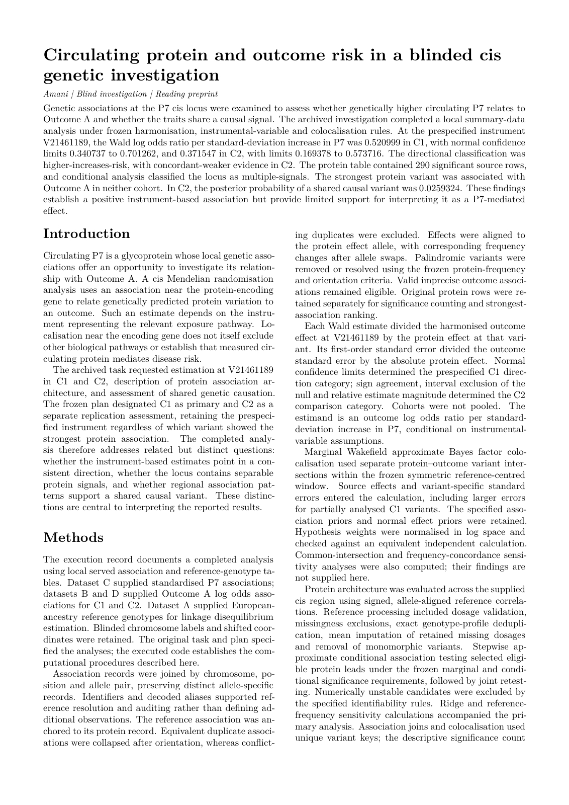

# GPNMB and Parkinson’s disease risk

Amani reproduced the primary GPNMB–Parkinson’s association and its direction in two cohorts, including the weaker replication estimate. The retired case passed **14/16 criteria**.

[Blind paper PDF](paper.pdf) · [page-one PNG](paper-page-1.png) · [paper source](paper.md) · [evaluated report](report.json) · [grade](grade.json) · [all retired Tier B cases](../README.md)



## The reveal

**Integrative clinical and genomic analyses reveal a causal role of GPNMB in the bone-brain axis of Parkinson’s disease.** Xingzhi Guo, Peiyao Wei, Wenzhi Shi, Rong Zhou and Rui Li (2026). [DOI: 10.1038/s41531-026-01325-8](https://doi.org/10.1038/s41531-026-01325-8). The paper linked above was drafted with the disguised names; this reveal was written separately afterwards.

| What Amani saw | Real identity |
|---|---|
| Protein P7 | GPNMB, glycoprotein non-metastatic melanoma protein B |
| Outcome A | Parkinson’s disease |
| Dataset C, protein GWAS | Open HELIC WGS pQTL data, Png et al. 2021; GCST90059975 |
| Cohort C1 / dataset B | IPDGC Parkinson’s meta-analysis; GCST009325 |
| Cohort C2 / dataset D | FinnGen R12, G6_PARKINSON |
| Dataset A | 1000 Genomes GRCh38 European reference genotypes; 503 individuals |
| V21461189 | rs199347, prespecified reference instrument |
| V21461927 | rs75801644, strongest protein-associated variant |
| ind001–ind503 | Renamed European reference-panel individuals |

## How it was disguised

The gene, disease, cohorts, study identity and accessions were hidden. Variant and chromosome names received consistent keyed tokens; row order was permuted. Genomic positions were shifted by a shared constant, preserving distances and cross-table alignment while hiding the locus. Alleles, effect sizes, standard errors and p-values were retained; allele frequencies were rounded to four decimals. Cohort-specific file formats were converted to a common schema and source annotation/sample-count columns were removed. Reference individuals were renamed. This preserves the MR and LD calculations while preventing gene/disease-name lookup. The open exposure dataset differs from the publication’s exposure source, so reproducing a published odds ratio from memory would not reproduce the blinded numerical answer.

## Amani's blind result beside the published finding

| Finding | Published finding | Amani's blind result |
|---|---|---|
| Primary association | The published IVW estimate was OR 1.429 (95% CI 1.245–1.640) per SD higher GPNMB in the IPDGC cohort. | Reference-variant Wald log OR 0.52100 (0.34074–0.70126), equivalent to OR 1.684 (1.406–2.016). Direction: higher GPNMB, higher Parkinson’s risk. |
| Replication direction and strength | The FinnGen estimate was positive and weaker: OR 1.235 (1.092–1.397). | Log OR 0.37155 (0.16938–0.57372), equivalent to OR 1.450 (1.185–1.775); the replication was concordant and weaker. |
| Locus architecture | The study concerns genetic evidence at the GPNMB locus. | Amani identified multiple protein-association signals and found that the strongest protein variant itself was not associated with the outcome in either cohort. |

The reproduced result is the primary association, its positive direction, interval exclusion of the null in both cohorts, and the weaker replication estimate. The blinded case uses the open HELIC exposure and a reference-variant Wald ratio; the paper uses a different exposure dataset and clumped IVW, so numerical equality is not claimed.

**Grade: 14/16 criteria.** This is the sealed one-shot grade from the final blind run, retained unchanged after retirement. Benchmark criteria and the software kernel's scientific claim labels are distinct: the reading paper preserves the native labels and pending manuscript-review status. It is not an endorsed submission package.

## Data and licence

**Fetch-only for the combined input.** The two GWAS Catalog sources use the [Catalog’s CC0 policy](https://www.ebi.ac.uk/gwas/docs/about/#licensing-information). The other inputs are public [FinnGen R12 summary statistics](https://www.finngen.fi/en/access_results) and the [1000 Genomes reference panel](https://www.internationalgenome.org/data). A clear redistribution licence covering the combined staged input was not established, so no measurements or individual genotypes are bundled. The fetcher retrieves only the original public releases and genomic slices, then rebuilds the dosage table and disguise. It never uses the publication’s access-controlled exposure.

FinnGen acknowledgement: we acknowledge the participants and investigators of the FinnGen study. Cite Kurki et al., *FinnGen provides genetic insights from a well-phenotyped isolated population* (2023), [10.1038/s41586-022-05473-8](https://doi.org/10.1038/s41586-022-05473-8).

From the repository root:

```sh
nice -n 10 packages/bio-baseline/.pixi/envs/default/bin/python examples/replications/gpnmb-parkinsons/fetch_data.py
```

[Fetcher](fetch_data.py) · [staging code](stage_data.py) · [projection recipe](projection.json.gz) · [data contract](DATA-CONTRACT.json). The recipe records curation name maps and row/column permutations, with measurements read from the original downloads. Every recreated served-file checksum is verified. Pass a destination directory as the first argument to write the data elsewhere.

## The question Amani received

The following is verbatim from the served task, including the disguised data description and analysis instructions. [The complete served task](TASK.md) also includes the file inventory and report-field specification.

<details>
<summary>Read the served question and disguised data description</summary>

````text
# Does genetically higher circulating protein P7 change the risk of Outcome A?

You are given genetic association summary statistics for one gene region: the gene that encodes **protein P7** (a circulating glycoprotein) plus about 500 kb on each side. Carry out a cis Mendelian randomisation and colocalisation analysis of P7 and Outcome A, and report the quantities listed below.

## Data

All four tables cover the same window. Chromosome labels are blinded and positions are shifted by one secret constant, so distances between variants are preserved and positions are comparable across tables. `variant` holds blinded identifiers: the same token means the same source identifier in every table (a cell may list several tokens separated by commas, or be empty). Alleles are real.

- Dataset C, table `protein-gwas`: association with P7 levels in about 2,900 European-ancestry adults. `beta` is per copy of `effect_allele`, in standard-deviation units of P7.
- Dataset B, table `outcome-gwas` (cohort **C1**): case-control GWAS meta-analysis of Outcome A (a binary disease) in European-ancestry samples. The effective sample size is about 125,000 for variants analysed in every contributing study; some variants were analysed in only part of the meta-analysis, and their standard errors are larger. `beta` is the log odds ratio per copy of `effect_allele`.
- Dataset D, table `outcome-gwas` (cohort **C2**): a separate case-control GWAS of Outcome A in European-ancestry samples, effective sample size about 23,000. `beta` is the log odds ratio per copy of `effect_allele`.
- Dataset A, table `reference-genotypes`: genotype dosages (copies of `counted_allele`: 0, 1 or 2) for 503 unrelated European-ancestry reference individuals (columns `ind001` to `ind503`), for linkage disequilibrium. It has no `variant` column; match it to the other tables on position and alleles.

## Conventions

- Harmonise the tables on position and allele pair and express every effect for the same allele. Drop palindromic variants (A/T or C/G) whose minor allele frequency in the protein table is above 0.42.
- The study group pre-specified variant V21461189 (the *reference variant*) as the instrument for the primary estimate.
- Colocalisation settings: Wakefield approximate Bayes factors with priors p1 = p2 = 1e-4 and p12 = 1e-5, prior standard deviation 0.15 for the protein effect (treat P7 as standardised) and 0.2 for the log odds ratio, using the variants within 50 kb (either side) of the reference variant. Choices not fixed by these settings are yours; describe the colocalisation analysis you ran in `coloc.method`.

## What to report (report.json)

1. Mendelian randomisation at the reference variant, per cohort. `mr.c1.wald_lnor` and `mr.c2.wald_lnor`: the Wald-ratio estimate, as the log odds ratio of Outcome A per 1-SD higher P7. `mr.c1.wald_ci_lower`, `mr.c1.wald_ci_upper`, `mr.c2.wald_ci_lower` and `mr.c2.wald_ci_upper`: the lower and upper bounds of its 95% confidence interval, using the first-order standard error (outcome standard error divided by the absolute protein effect). Each is a JSON number.
2. `direction`: your overall conclusion, one of `higher-decreases-risk`, `higher-increases-risk`, `no-detectable-effect`.
3. `replication`: how C2 compares with C1 at the reference variant: `concordant-not-weaker` (same sign, the C2 95% confidence interval excludes zero, and the C2 estimate is not smaller in absolute value than C1), `concordant-weaker` (same sign, the C2 interval excludes zero, and the C2 estimate is smaller), `not-significant` (same sign, the C2 interval includes zero) or `opposite-direction`.
4. Locus description. `locus.reference_variant_outcome`: `associated-in-both`, `associated-in-neither` or `associated-in-one`, according to whether the reference variant has an Outcome A p-value below 0.05 in C1 and in C2. `locus.n_significant_variants`: the number of variants (rows) in the protein table with a P7 p-value below 5e-8 (a JSON number). `locus.strongest_variant`: the `variant` token of the variant with the smallest P7 p-value in the protein table. `locus.strongest_variant_outcome`: the same three categories, for that variant. `locus.architecture`: `multiple-signals` if more than one independent signal is present (a signal counts as independent when its lead variant keeps a P7 p-value below 5e-8 after conditioning on the stronger signal or signals), or `single-signal` if the P7 associations in the protein table are explained by one association signal.
5. Colocalisation, per cohort. `coloc.c1.pp_h4` and `coloc.c2.pp_h4`: the posterior probability that P7 and Outcome A share one causal variant (a JSON number). `coloc.c1.verdict` and `coloc.c2.verdict`: `distinct-variants` (PP.H3 at least 0.8), `inconclusive` (otherwise) or `shared-variant` (PP.H4 at least 0.8). `coloc.method`: what you did, in prose.
6. Data integrity. Report the duplicated or overlapping units/samples found (list; empty if none), the other data-quality problems found (list; empty if none), and the units of analysis used.

Report template (placeholders in angle brackets; replace each with your value). Fill every field; only the fields listed under Report below are graded.

```
{
  "mr": {
    "c1": {"wald_lnor": <a JSON number>, "wald_ci_lower": <a JSON number>, "wald_ci_upper": <a JSON number>},
    "c2": {"wald_lnor": <a JSON number>, "wald_ci_lower": <a JSON number>, "wald_ci_upper": <a JSON number>}
  },
  "direction": "<higher-decreases-risk | higher-increases-risk | no-detectable-effect>",
  "replication": "<concordant-not-weaker | concordant-weaker | not-significant | opposite-direction>",
  "locus": {
    "reference_variant_outcome": "<associated-in-both | associated-in-neither | associated-in-one>",
    "n_significant_variants": <a JSON number>,
    "strongest_variant": "<variant token>",
    "strongest_variant_outcome": "<associated-in-both | associated-in-neither | associated-in-one>",
    "architecture": "<multiple-signals | single-signal>"
  },
  "coloc": {
    "c1": {"pp_h4": <a JSON number>, "verdict": "<distinct-variants | inconclusive | shared-variant>"},
    "c2": {"pp_h4": <a JSON number>, "verdict": "<distinct-variants | inconclusive | shared-variant>"},
    "method": "<short description>"
  },
  "integrity": {
    "duplicated_or_overlapping_units": [<identifier>, ...],
    "other_data_quality_problems": [<short description>, ...],
    "units_of_analysis": "<short description>"
  },
  "caveats": [<short description>, ...]
}
```
````

</details>

## Records and reproduction

[Paper inputs](paper-input.json) preserve the blinded task, frozen executed code, selected evaluated facts and native scientific claim statuses. [Draft provenance](drafter-provenance.json) records the live Codex call and usage. [Build checks](build.json) record journal/phase-chain, frozen-code, output-snapshot, deliverable and served-manifest checks, PDF hash and zero overfull warnings. The reveal and grading answer were not supplied to the paper drafter.

The original investigation was not rerun or regraded for this showcase. Data staging and document rendering were replayed separately. The paper uses Amani's journal preprint layout; cross-family manuscript review and owner endorsement remain pending.
