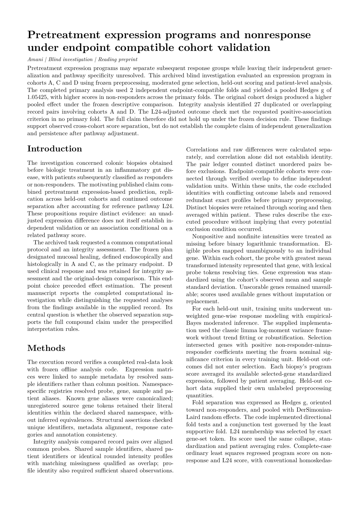

# Infliximab response: expression signal and independent cohorts

Amani recovered the pretreatment expression signal, detected shared patients across nominal cohorts, and separated the signal from an independently validated predictor. The retired case passed **8/8 criteria**.

[Blind paper PDF](paper.pdf) · [page-one PNG](paper-page-1.png) · [paper source](paper.md) · [evaluated report](report.json) · [grade](grade.json) · [all retired Tier B cases](../README.md)



## The reveal

**A reproducible pretreatment mucosal-inflammatory-remodeling state is associated with induction-phase anti-tumor necrosis factor non-response in ulcerative colitis.** Hongwei Zheng, Xin Zhuang and Wenbiao Chen (2026). [DOI: 10.3389/fgene.2026.1845510](https://doi.org/10.3389/fgene.2026.1845510). The paper linked above was drafted with the disguised names; this reveal was written separately afterwards.

| What Amani saw | Real identity |
|---|---|
| Inflammatory gut disease | Ulcerative colitis |
| Unnamed biologic | Infliximab, an anti-TNF treatment |
| Cohort A | GSE12251; mucosal-healing response |
| Cohort C | GSE16879; mucosal-healing response |
| Cohort D | GSE23597; clinical response |
| Dataset B | GPL570 probe annotation and MSigDB Hallmark gene sets |
| L24 | HALLMARK_INFLAMMATORY_RESPONSE |
| PB… / G… | Affymetrix probe identifiers / gene symbols |
| S… / U… | Biopsy identifiers / patient identifiers |

## How it was disguised

The disease, drug, studies, accessions, platform and pathway collection were hidden. Probes, genes, samples and patients received consistent keyed tokens; gene sets received keyed category labels, including L24. Rows and matrix columns were permuted. Only annotated probes were retained, and intensities with more than three decimal places were rounded half-even to three decimals. Outcome definitions were paraphrased without their original timing. Duplicate expression profiles remained identical after rounding, so overlap could still be discovered. These changes remove gene-name and accession lookup routes while preserving the expression contrasts and the evidence needed to audit independence. A memorized published pooled effect cannot supply the coded overlapping cohorts, the independent-unit analysis or the masked pathway adjustment.

## Amani's blind result beside the published finding

| Finding | Published finding | Amani's blind result |
|---|---|---|
| Non-response expression signal | The program was higher in non-responders; published three-cohort pooled Hedges’ g = 1.36 (95% CI 0.83–1.89). | Higher in non-responders; pooled Hedges’ g = 1.05425 over two independent, endpoint-compatible folds. |
| Inflammation and interpretation | The paper describes substantial overlap with baseline inflammation and remodeling, while retaining adjusted associations in its original cohort analysis. | After L24 adjustment, no primary fold met the positive-and-significant outcome criterion. Amani detected overlap between A and D and returned “does-not-hold-up” for the stronger independence/prediction claim. |

The grade measures the full retired-case audit, including detecting overlap. It does not mean that Amani endorsed the paper’s claim of three independent replications. The reported 27 overlapping record pairs follow the run’s patient/profile counting rule; they are not 27 distinct patients.

**Grade: 8/8 criteria.** This is the sealed one-shot grade from the final blind run, retained unchanged after retirement. Benchmark criteria and the software kernel's scientific claim labels are distinct: the reading paper preserves the native labels and pending manuscript-review status. It is not an endorsed submission package.

## Data and licence

**Fetch the measurements; redistribute the Hallmark annotation under CC BY 4.0.** The expression matrices and GPL570 annotation come from public GEO records [GSE12251](https://www.ncbi.nlm.nih.gov/geo/query/acc.cgi?acc=GSE12251), [GSE16879](https://www.ncbi.nlm.nih.gov/geo/query/acc.cgi?acc=GSE16879), [GSE23597](https://www.ncbi.nlm.nih.gov/geo/query/acc.cgi?acc=GSE23597) and [GPL570](https://www.ncbi.nlm.nih.gov/geo/query/acc.cgi?acc=GPL570). No dataset-specific redistribution licence was established, so those files are downloaded from GEO. The [GEO disclaimer](https://www.ncbi.nlm.nih.gov/geo/info/disclaimer.html) distinguishes public access from submitters’ rights.

The bundled [disguised Hallmark membership](hallmark-disguised.tsv.gz) adapts MSigDB Human Hallmark v2024.1.Hs, © Broad Institute, MIT and Regents of the University of California, under [CC BY 4.0 and MSigDB terms](https://www.gsea-msigdb.org/gsea/msigdb_license_terms.jsp). Changes: keyed gene/set names and row permutation. Cite Liberzon et al., *The Molecular Signatures Database hallmark gene set collection* (2015), [10.1016/j.cels.2015.12.004](https://doi.org/10.1016/j.cels.2015.12.004).

From the repository root:

```sh
nice -n 10 python3 examples/replications/infliximab-response/fetch_data.py
```

[Fetcher](fetch_data.py) · [staging code](stage_data.py) · [projection recipe](projection.json.gz) · [data contract](DATA-CONTRACT.json). The recipe records curation name maps and row/column permutations, with measurements read from the original downloads. Every recreated served-file checksum is verified. Pass a destination directory as the first argument to write the data elsewhere.

## The question Amani received

The following is verbatim from the served task, including the disguised data description and analysis instructions. [The complete served task](TASK.md) also includes the file inventory and report-field specification.

<details>
<summary>Read the served question and disguised data description</summary>

````text
# Pre-treatment program and early non-response

An inflammatory gut disease. Colonic biopsies were taken before the first dose of a biologic, and each patient was later classified as a responder or a non-responder. A published analysis reports three things: a pre-treatment gene-expression program predicts early non-response; the prediction replicates in held-out data from each of three cohorts (A, C and D), each cohort held out in turn with the genes selected in the other two; and the program still separates the outcome groups after adjustment for a reference pathway score.

Question: does the published claim hold up in these data? Report the held-out effect size under the protocol below, its comparison with the published three-cohort design, the adjusted check, and the data-integrity section of the report template.

## Data (offline, one look)

- `<cohort>-expression.tsv`: processed probe-level array intensities (not log-transformed; values with more than three decimals were rounded to three); probes with at least one mapped gene in rows, biopsies in columns.
- `<cohort>-samples.tsv`: one row per biopsy with its patient, its outcome (`responder` or `non-responder`) and the outcome definition used by that cohort.
- `B-probe-genes.tsv`: probe-to-gene map (several genes for one probe are separated by `;`).
- `B-gene-sets.tsv`: membership of reference pathway gene sets with keyed names, one gene per row.

## Held-out effect size (use this protocol so that answers are comparable)

Use leave-one-unit-out validation over the units of analysis you use (report them in the data-integrity section). Each unit serves once as the held-out fold and otherwise as training data:

1. Work on log2 intensities; treat non-positive intensities as missing. Within each cohort, keep the probes that map to exactly one gene and collapse them to genes by keeping, for each gene, the probe with the highest mean log2 intensity.
2. For each held-out unit, select the genes that are higher in non-responders at nominal two-sided p < 0.05 (two-group moderated t-test, non-responders versus responders) in every training unit (all units except the held-out one).
3. Score every biopsy of the held-out unit as the mean within-cohort z-score of the selected genes.
4. In each held-out fold, compute Hedges' g of the score (non-responders minus responders). Pool the folds, one per unit, with DerSimonian-Laird random effects.

Also reproduce the published three-cohort design with the same steps: each of the three cohorts is held out in turn, with the genes selected in both other cohorts.

## Adjusted check

In each of your held-out folds, regress the held-out score by ordinary least squares on the outcome (1 = non-responder, 0 = responder) and on the sample-level score of gene set `L24` (the mean within-cohort z-score of its genes after the same probe-to-gene collapse). Report the outcome coefficient and its p-value per fold.

## Report template

Fill every field; only the fields listed under Report below are graded. Placeholders in angle brackets stand for your values.

```
{
  "direction": "<allowed value>",
  "effect_size": {
    "folds": [{"held_out": "<dataset letter(s)>", "g": <JSON number>, "se": <JSON number>}],
    "n_folds": <JSON number>,
    "pooled_g": <JSON number>,
    "pooled_ci95": [<JSON number>, <JSON number>],
    "three_cohort_g": <JSON number>,
    "three_cohort_comparison": "<allowed value>"
  },
  "adjusted": {
    "folds": [{"held_out": "<dataset letter(s)>", "outcome_coef": <JSON number>, "outcome_p": <JSON number>}],
    "outcome_effect": "<allowed value>"
  },
  "data_integrity": {
    "duplicated_or_overlapping": ["<dataset letter>"],
    "n_duplicated_or_overlapping_pairs": <JSON number>,
    "other_problems": ["<free text>"],
    "units_of_analysis": "<free text>"
  },
  "verdict": "<allowed value>"
}
```

Data-integrity fields: `duplicated_or_overlapping` = duplicated or overlapping units/samples found (list; empty if none); `n_duplicated_or_overlapping_pairs` = number of duplicated or overlapping sample pairs found (0 if none); `other_problems` = other data-quality problems found (list; empty if none); `units_of_analysis` = units of analysis used.
````

</details>

## Records and reproduction

[Paper inputs](paper-input.json) preserve the blinded task, frozen executed code, selected evaluated facts and native scientific claim statuses. [Draft provenance](drafter-provenance.json) records the live Codex call and usage. [Build checks](build.json) record journal/phase-chain, frozen-code, output-snapshot, deliverable and served-manifest checks, PDF hash and zero overfull warnings. The reveal and grading answer were not supplied to the paper drafter.

The original investigation was not rerun or regraded for this showcase. Data staging and document rendering were replayed separately. The paper uses Amani's journal preprint layout; cross-family manuscript review and owner endorsement remain pending.
