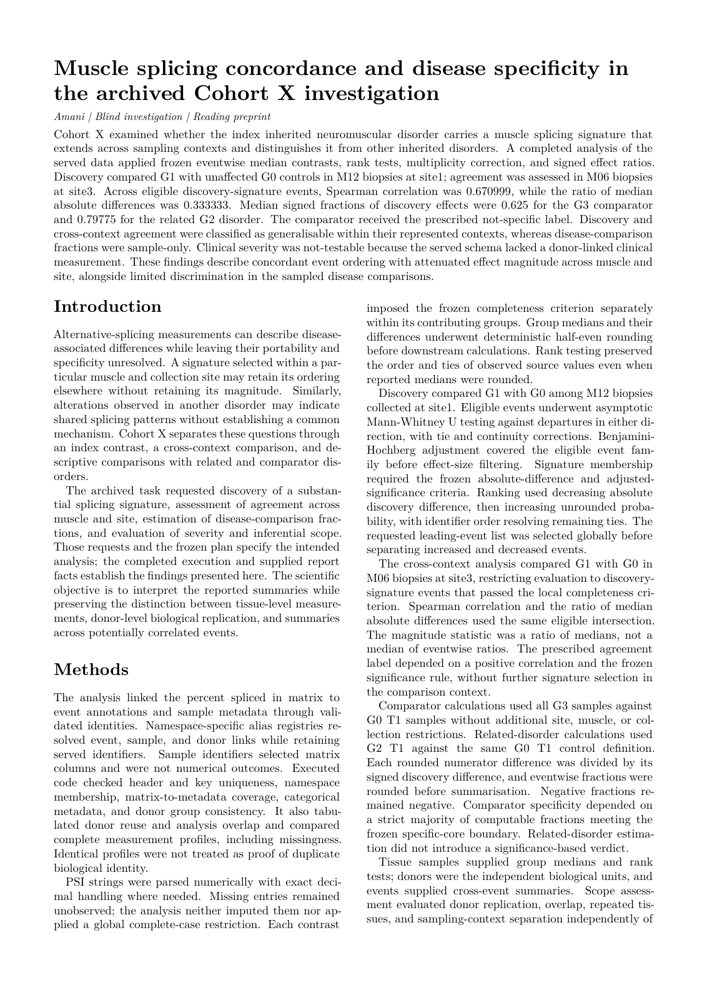

# A muscle splicing signature across tissues and disorders

Amani reproduced the direction and attenuation of a splicing signature in a second muscle/site, quantified comparator overlap, and preserved the limits imposed by the sampled donors. The retired case passed **12/15 criteria**.

[Blind paper PDF](paper.pdf) · [page-one PNG](paper-page-1.png) · [paper source](paper.md) · [evaluated report](report.json) · [grade](grade.json) · [all retired Tier B cases](../README.md)



## The reveal

**Transcriptome alterations in myotonic dystrophy skeletal muscle and heart.** Eric T. Wang, Daniel Treacy, Katy Eichinger, Adam Struck, Joseph Estabrook, Hailey Olafson, Thomas T. Wang, Kirti Bhatt, Tony Westbrook, Sam Sedehizadeh, Amanda Ward, John Day, David Brook, J. Andrew Berglund, Thomas Cooper, David Housman, Charles Thornton and Christopher Burge (2019). [DOI: 10.1093/hmg/ddy432](https://doi.org/10.1093/hmg/ddy432). The paper linked above was drafted with the disguised names; this reveal was written separately afterwards.

| What Amani saw | Real identity |
|---|---|
| Cohort X | GSE86356 / DMseq human muscle and heart RNA-seq |
| G0 | Unaffected controls |
| G1 | Myotonic dystrophy type 1 (DM1; DMPK repeat expansion) |
| G2 | Myotonic dystrophy type 2 (DM2; CNBP repeat expansion) |
| G3 | Duchenne muscular dystrophy (DMD), comparator |
| M12 / M06 | Tibialis anterior / quadriceps |
| T1 / T2 | Skeletal / cardiac tissue |
| site1 / site3 | Original anonymised collection centres A / B |
| E… / S… / DN… | Splicing-event coordinates / sample identifiers / anonymised donor identifiers |

## How it was disguised

Disease names, characteristic genes, muscle names, accessions, authors, platform and study identity were removed. Events, samples and donors received keyed identifiers; muscle, tissue and site labels were recoded, with row and sample-column permutations. The staged PSI matrix excludes comma-valued multi-isoform rows and retains events meeting the discovery coverage rule. PSI values remain the source fractions, already reported to two decimal places; no artificial scaling was applied. The task specifies deterministic median/difference rounding before thresholds. The resulting tables retain splicing contrasts and donor structure while preventing a named-event or disease-signature lookup from supplying the required masked identifiers and data-derived comparisons.

## Amani's blind result beside the published finding

| Finding | Published finding | Amani's blind result |
|---|---|---|
| Cross-muscle splicing direction | The study reports tissue-specific RNA-processing alterations and a skeletal-muscle splicing signature in myotonic dystrophy. | The second muscle/site replicated the direction: Spearman rho 0.67100 and magnitude ratio 0.33333; verdict “replicates”. These are the case-defined reanalysis quantities, not quoted publication point estimates. |
| Specificity and scope | The study includes DM1, a limited DM2 group and Duchenne comparator samples. | Comparator median f = 0.625; the signature was not disorder-specific under the task rule, while a specific core was identified. DM2 median f = 0.79775. Comparator and related-disorder conclusions were sample-only; discovery and replication were generalisable under the case’s scope rule. |

Only reproduced findings are highlighted here. Clinical severity was correctly marked not-testable from the served tables, which omit the required phenotype; that answer is not evidence against the publication’s severity association. The published article does not report point estimates for every case-defined comparison.

**Grade: 12/15 criteria.** This is the sealed one-shot grade from the final blind run, retained unchanged after retirement. Benchmark criteria and the software kernel's scientific claim labels are distinct: the reading paper preserves the native labels and pending manuscript-review status. It is not an endorsed submission package.

## Data and licence

**Fetch-only.** The public source is [GSE86356](https://www.ncbi.nlm.nih.gov/geo/query/acc.cgi?acc=GSE86356), including its PSI supplement and series metadata. No dataset-specific redistribution licence was established. The [GEO disclaimer](https://www.ncbi.nlm.nih.gov/geo/info/disclaimer.html) allows public access while preserving any submitter rights, so the measurements are downloaded from the original source. The fetcher runs the retired case’s final staging code and replays the published identifier maps and permutations.

From the repository root:

```sh
nice -n 10 python3 examples/replications/muscle-splicing/fetch_data.py
```

[Fetcher](fetch_data.py) · [staging code](stage_data.py) · [projection recipe](projection.json.gz) · [data contract](DATA-CONTRACT.json). The recipe records curation name maps and row/column permutations, with measurements read from the original downloads. Every recreated served-file checksum is verified. Pass a destination directory as the first argument to write the data elsewhere.

## The question Amani received

The following is verbatim from the served task, including the disguised data description and analysis instructions. [The complete served task](TASK.md) also includes the file inventory and report-field specification.

<details>
<summary>Read the served question and disguised data description</summary>

````text
# Cohort X: a muscle splicing signature

Cohort X is a bulk RNA-seq study of human muscle tissue collected at several sites. You receive three tables:

- `data/A-psi.tsv`: one row per alternative-splicing event, one column per sample. Each cell is the event's percent spliced in (PSI, a fraction from 0 to 1, given to 2 decimal places); `n/a` means not quantified in that sample.
- `data/A-events.tsv`: the type of each event (`SE` skipped exon, `MXE` mutually exclusive exons, `ALTSS` alternative 5' or 3' splice site, `RI` retained intron).
- `data/A-samples.tsv`: for each sample, the donor (coded), the group, the muscle (coded), the tissue class (coded), the collection site (coded) and the collection type (`biopsy` or `autopsy`).

Groups: `G0` = unaffected controls; `G1` = an inherited neuromuscular disorder (the index disorder); `G2` = a related inherited disorder; `G3` = a different inherited muscle disease (the comparator).

Question: does muscle from the index disorder carry a reproducible splicing signature, how specific is it to that disorder, does it track clinical severity, and how far do the results generalise? Use the definitions below so that results are comparable.

Arithmetic convention: medians and differences of PSI values are exact multiples of 0.005. Round every group median and every dPSI to 3 decimal places, and every f (step 3) to 4 decimal places, before using them in any threshold, ranking, median or ratio. This removes floating-point noise.

1. Discovery. Compare `G1` with `G0` among the `biopsy` samples of muscle `M12` collected at site `site1`. Keep events with a PSI value in at least 75% of the samples of each of the two groups. For each kept event, dPSI_disc = median PSI in `G1` minus median PSI in `G0`. Test each kept event with a two-sided Mann-Whitney U test, using the normal approximation with tie correction and continuity correction (an event whose values are all tied gets p = 1), and apply the Benjamini-Hochberg correction across all kept events. The signature is the set of events with |dPSI_disc| >= 0.20 and q < 0.05. Report the number of signature events. Rank the signature events by |dPSI_disc|, largest first (ties: smaller p first), and report the top 50, split by the sign of dPSI_disc.

2. Replication. For the signature events, compute dPSI_rep the same way (same 75% rule) for `G1` versus `G0` among the `biopsy` samples of muscle `M06` collected at site `site3`. Over the signature events kept at both sites, report the Spearman correlation between dPSI_disc and dPSI_rep, the magnitude ratio median(|dPSI_rep|) / median(|dPSI_disc|), and a verdict: `replicates` if the Spearman correlation is positive with a two-sided p < 0.05, otherwise `does-not-replicate`.

3. Comparator. For each signature event, f = (median PSI over all `G3` samples minus median PSI over all `G0` samples of tissue class `T1`, from any site or collection type) / dPSI_disc, applying the same 75% rule within each of those two groups. An f near 0 means the comparator looks like controls for that event; an f near 1 means it looks like the index disorder. Report the median f, the specific core (the signature events with f < 0.25), and a verdict: `specific` if more than half of the signature events with a computable f fall in the specific core, otherwise `not-specific`.

4. Related disorder. Compute the same f with the `G2` samples of tissue class `T1` in place of `G3`, and report its median.

5. Severity. Does the index-disorder signature track clinical severity across patients? Answer one of:
   - `does-not-track-severity`: the data allow the test, and the signature is not associated with severity;
   - `not-testable`: the data do not allow the test;
   - `tracks-severity`: the data allow the test, and the signature is associated with severity.

6. Scope. For each of steps 1 to 4, state whether its result supports conclusions about the conditions compared in general (`generalisable`) or describes only the particular individuals sampled (`sample-only`).

7. Data integrity. Report the duplicated or overlapping units/samples found (list; empty if none), the other data-quality problems found (list; empty if none), and the units of analysis used.

Report template (placeholders in angle brackets; replace each with your value):

```
{
  "discovery":   {"n_signature": <a JSON number>,
                  "top50_increased": [<event identifier>, ...],
                  "top50_decreased": [<event identifier>, ...]},
  "replication": {"spearman_rho": <a JSON number>,
                  "magnitude_ratio": <a JSON number>,
                  "verdict": "<does-not-replicate | replicates>"},
  "comparator":  {"median_f": <a JSON number>,
                  "specific_core": [<event identifier>, ...],
                  "specificity": "<not-specific | specific>"},
  "related":     {"median_f": <a JSON number>},
  "severity":    {"verdict": "<does-not-track-severity | not-testable | tracks-severity>"},
  "scope":       {"discovery": "<generalisable | sample-only>",
                  "replication": "<generalisable | sample-only>",
                  "comparator": "<generalisable | sample-only>",
                  "related": "<generalisable | sample-only>"},
  "integrity":   {"duplicated_or_overlapping_units": [<identifier>, ...],
                  "other_data_quality_problems": [<short description>, ...],
                  "units_of_analysis": "<short description>"}
}
```
````

</details>

## Records and reproduction

[Paper inputs](paper-input.json) preserve the blinded task, frozen executed code, selected evaluated facts and native scientific claim statuses. [Draft provenance](drafter-provenance.json) records the live Codex call and usage. [Build checks](build.json) record journal/phase-chain, frozen-code, output-snapshot, deliverable and served-manifest checks, PDF hash and zero overfull warnings. The reveal and grading answer were not supplied to the paper drafter.

The original investigation was not rerun or regraded for this showcase. Data staging and document rendering were replayed separately. The paper uses Amani's journal preprint layout; cross-family manuscript review and owner endorsement remain pending.
